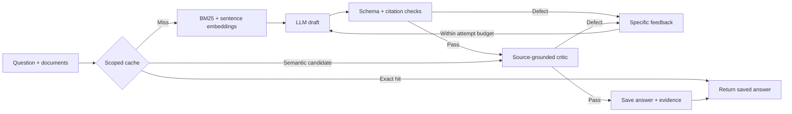

# AgentProof · Answer Lab

**A self-correcting LLM runtime with reproducible answer-quality, inference-cost and cache measurements.**

Ask questions from documents or extract typed records. Inspect the initial answer, the exact evidence, the critic’s feedback and each revision. Compare the final answer against independent reference labels, then see what the improvement cost.

[Recorded experiment console](https://hxrikumar.github.io/AgentProof/) · [Research and evaluation design](docs/ANSWER_LAB_RESEARCH.md) · [Frozen evaluation data](examples/answer-suite-v1/README.md) · [Earlier tool-action laboratory](README.v0.4.md)

## The workflow



The runtime does not see benchmark reference answers. A separate evaluator grades the actual outputs. A model can pass its own checks and still be wrong; those false accepts remain visible in the reports and console.

## What is implemented

- **Two useful tasks:** source-grounded question answering, including abstention; and JSON Schema extraction from incident reports, tickets or other documents.
- **Hybrid retrieval:** BM25 and local Sentence Transformer embeddings rank source passages. A lexical fallback is explicitly labelled when embeddings are absent.
- **Bounded self-correction:** deterministic feedback and a separately prompted critic identify defects. Revision stops when checks pass or the attempt budget is exhausted; every attempt and returned candidate is retained.
- **Configurable critic compute:** use separate model/token/thinking settings on the same OpenAI-compatible endpoint. Critic calls count toward total cost.
- **Selective SQLite cache:** only critic-accepted, non-abstaining responses are stored. Keys include source, schema, namespace, model and prompt fingerprints. Semantic candidates require compatibility checks and a fresh critique.
- **Experiment console:** source editing, question/extraction controls, attempt traces, citations, saved runs, per-case reference grading and downloadable JSON.
- **Fair comparisons:** one shared initial model response per case across direct, validation-only and critic-assisted policies. Logical standalone costs and actual experiment calls are counted separately.
- **Auditable evaluation:** frozen public-derived QA and authored extraction suites, per-case regression checks, paired bootstrap intervals, source hashes, atomic checkpoints and preserved failed outputs.

Python · FastAPI · Pydantic · JSON Schema · Sentence Transformers · SQLite · React · TypeScript · MLX local inference. The preserved tool-action laboratory also includes LangGraph and OpenTelemetry.

## Run locally

Python 3.12–3.14, Node 22+ and [uv](https://docs.astral.sh/uv/) are required.

```sh
uv sync --extra embeddings
npm --prefix web ci
npm --prefix web run build
```

On Apple Silicon, after caching the free pinned model, double-click `scripts/open-answer-lab.command`. The launcher starts the model and application, opens the workspace and stops its own processes when closed with Ctrl+C. It never configures a paid endpoint. See its message for the one-time model download command.

Alternatively, use an existing local OpenAI-compatible model server:

```sh
export ANSWER_LAB_BASE_URL=http://127.0.0.1:8089/v1
export ANSWER_LAB_MODEL=mlx-community/Qwen3.5-4B-MLX-4bit
export ANSWER_LAB_MODEL_REVISION=32f3e8ecf65426fc3306969496342d504bfa13f3
export ANSWER_LAB_DISABLE_THINKING=true
export ANSWER_LAB_MAX_TOKENS=768
.venv/bin/uvicorn agentproof.api:app --host 127.0.0.1 --port 8010
```

Open **http://127.0.0.1:8010**. Model-free recorded experiments are available from the sidebar. The old action workspace is at **/legacy**. SQLite history is local; the service has no tenant authentication and binds to localhost for normal use.

The optional critic overrides are `ANSWER_LAB_CRITIC_MODEL`, `ANSWER_LAB_CRITIC_MAX_TOKENS` and `ANSWER_LAB_CRITIC_DISABLE_THINKING`. Use environment configuration for credentials; never place keys in the UI or Git.

## Reproduce measurements

The frozen suite has **64 evaluation cases**: 48 SQuAD-derived reading questions and 16 synthetic extraction cases. A separate 18-case development split is kept for debugging. Public data may have appeared in model training; this is not an official SQuAD leaderboard submission. Details and licenses are in the [dataset card](examples/answer-suite-v1/README.md).

```sh
.venv/bin/python scripts/answer_benchmark.py run \
  --suite examples/answer-suite-v1/evaluation.json \
  --output-dir artifacts/my-answer-study

.venv/bin/python scripts/answer_cache_probe.py \
  --output-dir artifacts/my-cache-study
```

| Question | Metric |
| --- | --- |
| Did the answer match the reference? | QA exact match and token F1; extraction field accuracy |
| Did correction help? | Recovery rate, regression rate, paired confidence interval |
| Did the runtime mistakenly accept an answer? | False-accept rate against offline references |
| How much inference did it need? | Calls, retries and tokens per query; tokens per correct result |
| How long did it take? | End-to-end p50 and p95 latency |
| Did the cache help safely? | Exact/semantic hit counts, false hits, cold/warm latency |

Denominators and missing usage are explicit. A validation score is the fraction of checks passed, not a calibrated correctness probability. Exact warm-cache speedup applies to repeated requests; it is not faster reasoning on new questions. The same-model critic remains fallible, so stronger results are established only by the separate reference evaluation.

## Tests and previous work

```sh
uv run pytest -q
uv run ruff check src tests scripts
npm --prefix web test
npm --prefix web run build
```

The earlier refund/tool-action experiments, reports and release tags are preserved. They test a different problem and are not pooled into answer-quality metrics. See the [v0.4 project overview](README.v0.4.md) for those results.
