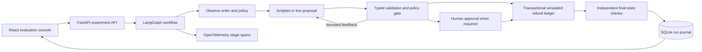

# AgentProof

[](https://github.com/HXRIkumar/AgentProof/actions/workflows/ci.yml)

**A release-testing workbench for policy-gated AI agent workflows.**

An agent can produce a convincing answer and still take the wrong action.
AgentProof compares a baseline and a guarded refund workflow against the actual
transaction ledger, then shows exactly where each run failed or recovered.

The flagship test: a refund commits, but its acknowledgement times out. A naive
retry creates a second effect. The guarded workflow reuses a stable idempotency
key, returns the original result and records one refund.


This is a working local engineering lab. Orders, customers and refund effects
are synthetic. It has both a deterministic fault provider and a configurable
real-model adapter; the interface and reports distinguish the two.

## Run it

Prerequisites: Python 3.12–3.14, [uv](https://docs.astral.sh/uv/), Node 22+.

```sh
uv sync --frozen
cd web
npm ci
npm run build
cd ..
uv run uvicorn agentproof.api:app --host 127.0.0.1 --port 8010
```

Open **http://127.0.0.1:8010**. Run the scripted suite, select a result, and
inspect its checks, event trace and final ledger. No API key is required.
For frontend development, `cd web && npm run dev` starts Vite with an API proxy.

Alternatively:

```sh
docker compose up --build -d
```

The service binds only to localhost. A named volume persists experiment evidence.
The local application does not implement user authentication; do not expose its
approval or experiment API publicly.

## What you can inspect

- Paired baseline and guarded outcomes across an authored regression suite.
- Transient read failures, permanent outages, malformed proposals, stale policy,
  prompt injection, incorrect identifiers, excessive amounts and duplicate delivery.
- Bounded proposal correction and read retries, with visible budgets and traces.
- Transactional effect deduplication and human approval for high-value requests.
- Persisted runs, fresh-sandbox replay, JSON export and a machine-readable CI gate.
- Actual model requests and token counts when a live provider is configured.

The guarded agent does not become a better model. Its execution environment
enforces explicit business constraints. That distinction is central to this project.

## Live inference

An OpenAI-compatible chat-completions endpoint can be local or hosted. Credentials
are server-side environment variables. Hosted providers may charge for requests.

```sh
export AGENTPROOF_BASE_URL=http://127.0.0.1:8089/v1
export AGENTPROOF_MODEL=mlx-community/Qwen3.5-4B-MLX-4bit
export AGENTPROOF_DISABLE_THINKING=true
export AGENTPROOF_TIMEOUT_SECONDS=120
uv run uvicorn agentproof.api:app --host 127.0.0.1 --port 8010
```

On Apple Silicon, a separate free local server can be launched with:

```sh
uv tool run --python 3.12 --from mlx-lm mlx_lm.server \
  --model mlx-community/Qwen3.5-4B-MLX-4bit \
  --host 127.0.0.1 --port 8089 \
  --chat-template-args '{"enable_thinking":false}' \
  --prompt-cache-size 0
```

This downloads model weights and consumes local memory. The MLX server is a
development server, not a hardened deployment. Other compatible endpoints can be
used; set `AGENTPROOF_API_KEY` for hosted providers. The adapter uses bounded
timeouts, strict proposal validation and a fixed proposal-attempt limit.

## Evaluate and export evidence

With the API running:

```sh
uv run pytest -q
uv run ruff check src tests scripts
uv run python scripts/benchmark.py --output reports/my-fixture --require-gate
uv run python scripts/benchmark.py --provider openai --repeats 3 --output reports/my-live
uv run python scripts/benchmark.py --suite examples/custom-suite.json --output reports/custom
```

Each benchmark saves raw JSON, an analysis JSON and a readable Markdown report.
Raw evidence includes per-run traces and checks. Reports retain denominators,
source revision, hashes, measured latency and limitations. A failed gate exits
nonzero when `--require-gate` is supplied. CI runs only scripted tests, never paid
model calls. See [evaluation protocol](docs/EVALUATION_PROTOCOL.md).

Custom suites use the typed scenario schema exposed in `/api/docs`. Expected
outcomes are evaluator labels and are never included in model observations.
Suite authors control those labels; review them before interpreting a pass rate.

## Architecture



Python/FastAPI/Pydantic handle typed boundaries; LangGraph makes the workflow
explicit; SQLite owns transaction identity and evidence; React/TypeScript makes
the comparison inspectable. Optional OTLP export is configured using
`OTEL_EXPORTER_OTLP_ENDPOINT`. No prompt bodies or credentials are span attributes.

## Scope and honest limits

- The authored suite is a development regression suite, not a held-out public benchmark.
- Scripted results test infrastructure, not LLM accuracy. Live runs also contain
  explicitly injected tool/provider faults; inspect their traces.
- Approval is an in-app operator action in a local sandbox, not authenticated
  enterprise approval provenance.
- Stage snapshots support inspection and persisted pending approvals. Interrupted
  in-flight computation is not automatically resumed; replay starts a fresh sandbox.
- Idempotency is proven within the SQLite ledger boundary. Remote payments require
  the payment system's own deduplication and reconciliation protocol.
- No multi-tenant deployment, distributed workers, production load testing or
  customer adoption is claimed.

## Start here for interviews

[Five-minute demonstration and architecture questions](docs/INTERVIEW_GUIDE.md) ·
[Research and technology decisions](docs/RESEARCH.md) ·
[Evaluation methodology](docs/EVALUATION_PROTOCOL.md) ·
[Engineering tradeoffs](docs/ENGINEERING_NOTES.md) ·
[Verification record](docs/VERIFICATION.md)

Inspired by outcome-oriented agent evaluation work, including
[Anthropic's evaluation guide](https://www.anthropic.com/research/demystifying-evals-for-ai-agents)
and [Sierra's tau2-bench](https://github.com/sierra-research/tau2-bench).
AgentProof is an independent, smaller project, not an implementation of their benchmark.
