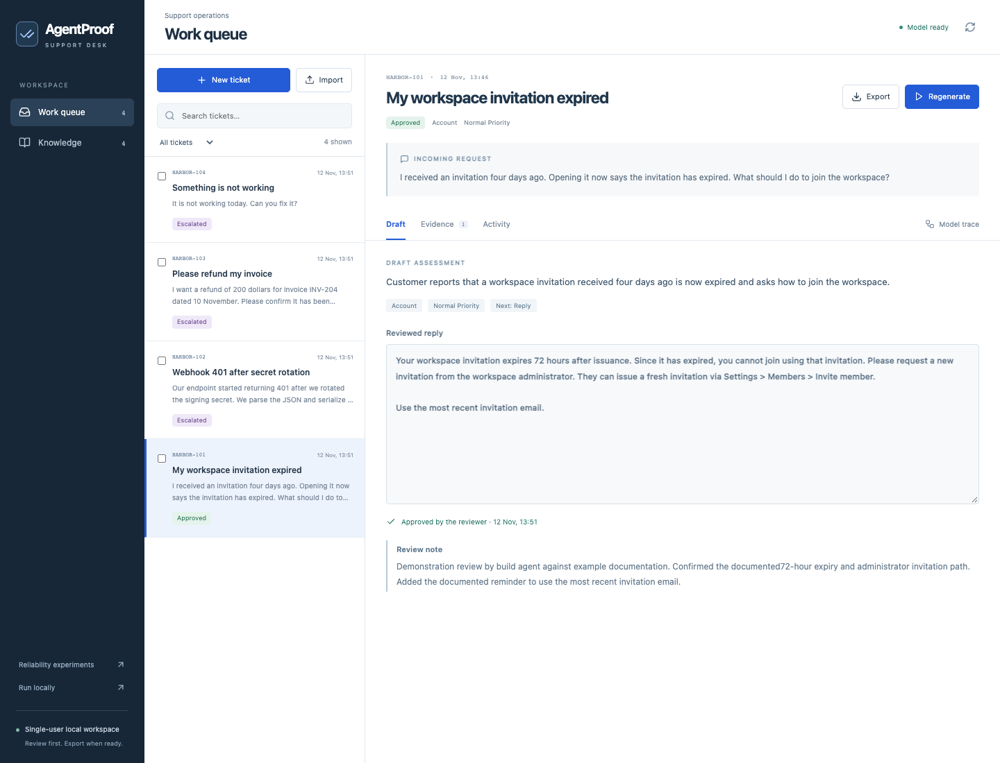
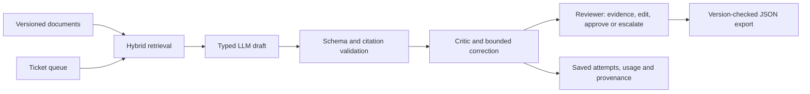

# AgentProof · SupportDesk

**Turn product documentation and incoming support tickets into cited drafts that a person can review and export.**

A developer's product can receive the same invitation, integration and billing questions every week. The answer is often somewhere in the documentation, but someone still has to find the relevant policy, check its version, write the reply and decide when to hand the request off. An LLM can help with the writing; a plausible answer alone is insufficient for that workflow.

AgentProof connects those steps: versioned knowledge → durable ticket processing → structured, cited drafts → explicit review → a portable handoff. Its reusable answer engine retrieves evidence, validates output, supplies targeted correction feedback and records the cost of each attempt.

[Recorded product demo](https://hxrikumar.github.io/AgentProof/) · [Get started](docs/SUPPORTDESK_GUIDE.md) · [Python integration](docs/SUPPORT_INTEGRATION.md) · [Why this project / interview guide](docs/PROJECT_STORY.md) · [Measured engine results](reports/ANSWER_FINDINGS.md)



## Try a real workflow

1. **Add knowledge:** upload Markdown, TXT or text PDF files. Document versions, pages and source passages remain inspectable.
2. **Bring in requests:** create a ticket or import CSV/JSON. Stable external IDs prevent accidental duplicate imports.
3. **Generate drafts:** queue selected tickets, close the browser, then return to their saved progress. Cancel queued work or request cancellation after the current inference.
4. **Review evidence:** inspect the proposed reply, source quotation, document version and model attempts. Edit a supported reply or escalate with a note.
5. **Export the decision:** download the reviewed response or handoff JSON for another system. Changed knowledge invalidates older approvals and exports.

The public demo contains **fictional Harbor documentation and tickets, actual recorded Qwen model outputs, and demonstration review actions performed by the build agent**. It is read-only and makes no model calls. The local application accepts your own inputs. Neither mode sends customer messages, changes accounts or issues refunds.

### What the recorded run actually did

| Request | Observed outcome |
|---|---|
| An expired workspace invitation | Produced a policy-supported reply; reviewer added the documented latest-email reminder, approved and exported it. |
| A webhook returning HTTP 401 | Generated broadly relevant advice but failed the exact-quotation check on all three attempts; the failed draft was preserved and escalated. |
| A refund request | Recommended escalation; approval was blocked for a financial action. Export retained the handoff reason. |
| “Something is not working” | Asked for missing information instead of inventing a diagnosis; reviewer exported a clarification handoff. |

[Raw recording](reports/support-demo-v1.json) · [Reviewed exports](reports/support/) · [Failure view](docs/screenshots/support-citation-failure.png). Four walkthrough tickets demonstrate behavior, **not support accuracy or customer productivity gains**.

## What an application developer can use

The browser and Python client use the same FastAPI service. Add the SDK to a small helpdesk, an internal product-support tool or a document-driven operations application:

```python
from agentproof.client import SupportClient

with SupportClient() as client:
    client.upload_document("product-guide.pdf")
    ticket = client.create_ticket(
        title="My workspace invitation expired",
        body="I opened the invitation four days after receiving it.",
        external_id="helpdesk-1042",
    )
    request_key = client.new_idempotency_key()  # Persist before submitting.
    job = client.process_ticket(ticket["id"], idempotency_key=request_key)
    client.wait_for_job(job["id"], timeout=180)
    draft = client.get_ticket(ticket["id"])
    # Display draft + evidence to the reviewer. Approval is a separate action.
```

The [integration guide](docs/SUPPORT_INTEGRATION.md) covers review, export, version conflicts and cancellation. The runnable [CLI example](examples/support_sdk.py) keeps generation and approval separate. There is no claimed Zendesk, Gmail or CRM connector: an application can consume the documented API/export contract.



**Stack:** Python, FastAPI, Pydantic, SQLite, Sentence Transformers, BM25, React and TypeScript; local MLX inference or optional efficient hosted inference. SQLite stores the work queue, document versions, reviews, traces and scoped response cache. No hosted key is needed for the local workflow.

## Run on Apple Silicon

Install Python 3.12–3.14, Node 22+ and [uv](https://docs.astral.sh/uv/), then:

```sh
uv sync --extra embeddings
npm --prefix web ci
npm --prefix web run build
uv run --extra embeddings hf download mlx-community/Qwen3.5-4B-MLX-4bit \
  --revision 32f3e8ecf65426fc3306969496342d504bfa13f3
uv run --extra embeddings hf download sentence-transformers/all-MiniLM-L6-v2 \
  --revision 1110a243fdf4706b3f48f1d95db1a4f5529b4d41
./scripts/open-supportdesk.command
```

Open **http://127.0.0.1:8010**. Upload `examples/supportdesk/knowledge/*.md`, then import `examples/supportdesk/tickets.csv`. These sample files are clearly fictional and include normal replies, missing information and a request needing a human decision. The launcher uses free local inference, overrides inherited paid-provider settings, and stops only the processes it started when closed with Ctrl+C.

For another local OpenAI-compatible endpoint, use the [manual setup](docs/SUPPORTDESK_GUIDE.md). Hosted inference is optional and requires [explicit configuration](docs/HOSTED_INFERENCE.md). Provider keys never go into the browser or repository.

## Evidence behind the answer engine

The support workflow uses an independently evaluated core. On **64 frozen QA/extraction cases**, local Qwen plus an efficient hosted critic and selective final-attempt escalation improved correctly delivered tasks from **38/64 (59.4%) to 50/64 (78.1%)**, a gain of **18.8 percentage points**. It recovered 13 initially unsuccessful tasks, regressed one initially successful task and used 0.453 retry generations per query. The paired 95% interval for the gain was +9.4 to +29.7 points on this workload.

The experiment also found a useful limit: a hosted generator with simpler validation-only correction reached **53/64** in the primary run and was cheaper and faster than critic-based correction. A repeat reversed the one-case accuracy ordering. More orchestration is not automatically better; the API exposes policy choices.

These are **answer-engine measurements, not accuracy on the four support tickets**. Unknown usage from failed hosted requests remains unknown. Warm exact-cache replays avoided model calls, but that does not accelerate new questions. Read the [full findings, failures, costs and limitations](reports/ANSWER_FINDINGS.md) and the [raw report manifest](reports/answer-release-manifest.json). The answer experiments remain accessible at `?workspace=answers`; the earlier tool-action lab remains at `?workspace=legacy`.

## Current scope

This is a working **single-user local application and integration SDK**, not a deployed multi-tenant helpdesk. It has no user authentication, email delivery, tenant isolation or live account access. Keep the API on localhost. Scanned PDFs need external OCR. Ticket analysis uses a bounded excerpt; truncation is visible and blocks reply approval. Citation matching verifies a quotation exists, not that every conclusion is true, so review remains necessary. Interrupted running jobs are marked failed and are not automatically retried; an already-sent hosted request may still incur a charge.

The engineering contribution is the connected workflow and its failure semantics: knowledge snapshots, durable jobs, idempotency, measured correction, inspectable evidence and review-aware exports. Existing support products solve related problems; this project does not claim to invent the category or to have real customer adoption.

Developer checks: `uv run pytest -q`, `uv run ruff check src tests scripts`, `npm --prefix web test`, `npm --prefix web run build`. The [earlier answer-runtime overview](README.answer-lab.md) and [v0.4 tool-action overview](README.v0.4.md) preserve prior work and reproducibility details.
