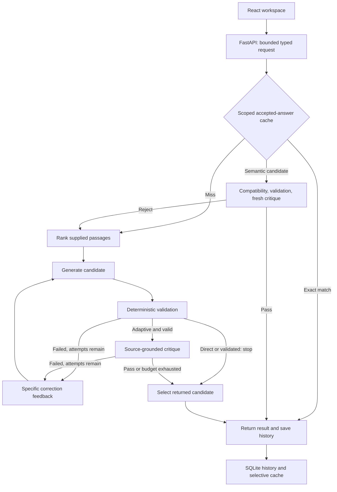

# Answer Lab: engineer demo and interview guide

Answer Lab improves and measures **document-grounded answers and structured
extraction**. It is the current AgentProof answer workspace. The older tool-action
laboratory and its [interview guide](INTERVIEW_GUIDE.md) remain separate; their
results do not measure this answer system.

This guide explains implemented behavior. It deliberately contains no final
performance claims while evaluation is being completed. Use the exact completed
report, model configuration and sample count when discussing a measured result.

## Explain the project in 45 seconds

> “I built an LLM answer runtime that takes documents and a question, retrieves
> relevant passages, and asks a model for a short answer with evidence or typed
> JSON. It checks the structure and citations, then can use a separately prompted
> critic to identify unsupported or unresponsive answers. Failed checks produce
> targeted feedback for a bounded retry. I compare direct generation, validation
> with retries, and critic-assisted correction using the same initial answer.
> The console shows every attempt, the returned answer and its inference cost.
> A separate evaluator checks reference correctness, because passing our runtime
> checks does not prove that an answer is true.”

The practical problem is that a usable-looking LLM response can contain the wrong
date, cite a real sentence that answers a different question, or return a string
where an application requires a boolean. A knowledge-base assistant or an incident
intake tool needs an answer it can inspect and a predictable failure path. The
project studies when correction helps enough to justify its extra calls and latency.

It does not train a foundation model. The engineering contribution is the runtime,
feedback contracts, selective reuse and auditable comparison around inference.

## Start the local workspace

Run these from the repository root. Requirements are Python 3.12–3.14, Node 22+
and `uv`. The bundled model launcher additionally requires Apple Silicon macOS.

```sh
uv sync --extra embeddings
npm --prefix web ci
npm --prefix web run build
```

Download the free generator weights once, while online:

```sh
uv run --extra embeddings hf download mlx-community/Qwen3.5-4B-MLX-4bit --revision 32f3e8ecf65426fc3306969496342d504bfa13f3
```

For hybrid retrieval during an exploratory demo, cache the optional embedding
weights too:

```sh
uv run --extra embeddings hf download sentence-transformers/all-MiniLM-L6-v2
```

This second command uses the current model revision; it is not a frozen benchmark
setup. Benchmark reports record the actual pinned embedding revision separately.
Installing the `embeddings` extra installs software, not model weights. If the
embedding package or cached weights cannot load, retrieval reports `bm25` and
semantic-cache lookup is unavailable. It does not silently claim hybrid retrieval.

Then double-click `scripts/open-answer-lab.command`, or run:

```sh
./scripts/open-answer-lab.command
```

The launcher supplies `mlx-lm==0.32.2`, starts the pinned local model on port 8089
and the application on port 8010, and opens **http://127.0.0.1:8010**. Keep its
terminal open; Ctrl+C stops the processes it started. It requires both ports to be
free and an existing web build. Startup logs are in `artifacts/answer-launcher/`.

The launcher deliberately removes inherited `ANSWER_LAB_*` settings and disables
paid inference. It is a local demo path, not a way to reproduce a hosted or frozen
benchmark configuration. It also does not preserve an externally set embedding
revision. Use the manual server configuration in the [README](../README.md#run-locally)
and [hosted guide](HOSTED_INFERENCE.md) for an explicitly configured comparison.
Do not launch a second local model while another benchmark is using port 8089.

The commands above were checked against dependency declarations and launcher code
for this guide; this documentation task did not start services or call a model.

## A five-minute demonstration

Use the built-in examples so an interviewer can read the evidence quickly. These
are demo inputs, not benchmark evidence. Let the actual output determine what you
say; do not promise that a particular run will need a correction.

| Open | Show | Say | Why it matters |
| --- | --- | --- | --- |
| **Workspace**, **Example: release notes** | The two different beta/general-release dates | “The answer must come from this supplied text, and it must answer the exact question.” | Related evidence can still support the wrong answer. |
| **Direct answer**, with **Reuse accepted answers** disabled | Click **Generate answer**, then **Answer & sources** | “This is one generation. Deterministic checks still inspect its format and evidence.” | A fair baseline is a real output, not a deliberately broken prompt. |
| **Correction trace** | Initial answer, checks, generation model and **Returned** marker | “The trace shows what happened. Checks passed is an operational verdict, not a truth label.” | A polished final answer alone hides failures and extra calls. |
| **Critique + refine**, attempt limit 3 | Generate, then inspect feedback and any revisions | “A revision occurs only after failed checks. A passing first answer stops immediately.” | More inference is conditional and bounded. |
| Change the question to “When was Atlas discontinued?” | Abstention or the actual failure | “The source gives release dates, not a discontinuation date. Correct behavior here is to abstain.” | Missing evidence is a valid outcome; a related date is not enough. |
| **Example: incident report** | **Output schema**, then the returned `data` and citation | “The output must have the requested fields and types, including a boolean for data loss.” | Typed extraction is useful to downstream software. |

The expected general-release date in the release-notes example is **22 July 2024**;
the example explicitly distinguishes it from the beta. This is a human-readable
demo check, not a claimed model result. In extraction, an empty `answer` string is
normal: the extracted record lives in `data`.

For a cache demonstration, use **Critique + refine**, enable **Reuse accepted
answers**, and run the same answerable input twice. A successfully admitted first
response can produce an `exact_hit` on the second run with no new model call.
If the first run failed or abstained, it is not cached. Change a source fact and
rerun to show that source changes invalidate reuse. Do not call a warm repeated
request “faster reasoning.”

Finish in **Experiments** with a completed recorded report, if one is available.
Show its configuration, a successful case and a failure or regression; use
**Export JSON** for the evidence. **Run history** contains workspace runs, whereas
**Experiments** contains curated benchmark reports. An empty experiment list is
not a reason to invent results. The public recorded viewer cannot run live models.

Two UI runs are useful for demonstration but are not a controlled comparison:
they generate separate initial answers. The benchmark runner shares one initial
generation across all three policies for each case.

## Architecture and policy decisions



The diagram abbreviates error exits and abstention handling. The answer runtime
is a small explicit Python loop; it does not require LangGraph. LangGraph belongs
to the preserved tool-action workflow. Each answer call has a typed input,
bounded context, a generation budget and a recorded terminal result.

| UI policy | Internal name | Behavior |
| --- | --- | --- |
| Direct answer | `baseline` | One generation, deterministic inspection, no critic or correction. |
| Validate + retry | `validated` | Up to the selected generation limit; retry on deterministic failure. |
| Critique + refine | `adaptive` | Same deterministic checks, then a critic for a valid candidate; retry on failed checks. |

Generation prompts are task-specific, but identical across these policies. The
limit is one to three **generations**, not total calls: each applicable critique
is another call. The runtime preserves every attempt. If a later candidate fails,
selection prefers an all-check pass, then a valid extraction payload, then a
deterministic pass and finally the check score; ties retain the earlier candidate.
This selection is a heuristic over checks, not access to the correct answer.

**Final-attempt escalation** is optional and off by default. With
`ANSWER_LAB_ESCALATE_FINAL=1`, adaptive can route its last permitted generation
to the configured critic endpoint/model when that route differs from the draft
route and earlier attempts failed. It uses the generation prompt, then still
requires deterministic validation and a critique. It neither raises the attempt
limit nor changes direct/validated runs. The trace records the route, generation
model and reason. A denied critic request stops further work rather than trying
an escalation after the budget guard has refused a call. Escalation is a candidate
cost/quality tradeoff, not an assumed improvement.

## Retrieval, validation and truth

**Retrieval:** supplied documents are split into passages of at most 2,400
characters with 160-character overlap, favoring sentence/newline boundaries.
BM25 scores lexical matches. If cached embeddings are available, a local Sentence
Transformer adds semantic similarity; ranking combines normalized lexical score
with nonnegative cosine similarity using fixed weights. The top four passages go
to the generator and critic. Selected source IDs, offsets, text and scores are
recorded. This is in-memory retrieval over a bounded pasted corpus, not a scalable
vector database or web search engine.

**Deterministic validation:** strict JSON parsing rejects duplicate keys and
invalid typed fields. Quotes must appear in the retrieved evidence; adjacent
retrieved coverage can be merged, but unseen gaps cannot be cited. QA answers
must be spans inside cited quotes, with word boundaries. Extraction `data` must
match the supplied JSON Schema. This catches structural defects and invented
citations. It does not prove that a real quote answers the question or that every
extracted value is associated with the right entity.

**Critique:** the reviewer assesses support, responsiveness and whether the
sources answer the question. For an explicit abstention, support/responsiveness
are not applicable; source answerability decides its semantic verdict. The
critic can share the generator model or use a separately configured model. It
receives no benchmark reference answer and is not an independent source of truth.
Both models can make the same mistake, obey an injected instruction, or reject a
correct answer. A different model reduces neither risk to zero.

**Offline correctness:** a separate evaluator compares final outputs with frozen
reference labels. A runtime `accepted` result means checks passed; an `abstained`
result means the selected policy accepted the refusal to answer. Neither alone
establishes reference correctness. `failed`/`error` results may retain a candidate
for diagnosis and must not be silently presented as delivered successes.

The validation score is a fraction of applicable checks passed. Check sets differ
by task, policy and abstention, so their mean is not calibrated confidence or a
comparable general “average reliability” metric.

## Cache and accounting

SQLite stores local history separately from the response cache. Only non-abstaining
adaptive responses accepted by validation and critique are admitted. Scope includes
namespace, source content, task/schema, provider/prompt configuration and embedding
availability; changing those must not reuse an old answer under a new setup. The
default TTL is one day. Exact matching normalizes whitespace; it is not semantic
equivalence.

Semantic reuse first finds a highly similar question in the same scope. A
number/negation signature rejects some meaning-changing queries, then the cached
candidate undergoes deterministic checks and a fresh critique on the new question.
The signature is intentionally limited; it does not establish entity equivalence.
Similarity and a critic pass can still yield a false hit. Report changed-query
and incorrect-hit outcomes, not just saved calls.

| Accounting term | What it means |
| --- | --- |
| Logical policy calls/tokens | What that policy would use on its own, including its share of the initial generation. |
| Actual experiment calls/tokens | Newly sent requests, counting the physically shared initial generation only once across policies. |
| Blocked call | No request was sent; retained as a failure reason, not reported as a free successful response. |
| Estimated hosted cost | Standard-price estimate from reported usage; unknown usage remains unknown. |
| Accounted hosted amount | Known estimates plus conservative reservations retained for uncertain outcomes. |
| End-to-end latency | Retrieval, checks, inference and cache handling; shared inference is attributed for policy comparison. |

The run also records physical wall latency separately. Its documented timing
excludes the final history write. Cache timing is a separate replay study. Local
API cost is zero but hardware, electricity and processing time are not free.

Optional paid calls reserve a conservative amount in a persistent transactional
ledger before sending. Processes and restarts share the same ceiling; unknown
outcomes retain their reservation. This is a client-side guard, not a provider
billing hard cap. See [hosted inference](HOSTED_INFERENCE.md) for configuration and
the exact accounting assumptions. Hosted mode sends the selected source context
and candidate to the configured provider; the local launcher does not.

## Discuss evaluation without overstating it

The frozen design separates **18 development cases** from **64 evaluation cases**:
48 public SQuAD-derived QA cases, balanced between answerable and unanswerable,
plus 16 authored extraction cases. Caching is disabled for quality comparisons;
cache replays form a separate study. Public source data may have appeared in model
training. These cases are not the complete SQuAD benchmark or independent evidence
of general-purpose reliability.

The [evaluation plan](ANSWER_EVALUATION_PLAN.md) defines delivered task success,
QA exact match/token F1, extraction field accuracy, recovery of initial failures,
regressions of initial successes, false accepts, tokens/cost per correct result
and latency. Paired case-level intervals describe uncertainty in differences.
Read denominators and completeness before quoting a number. A higher success rate
at greater cost is not automatically an efficiency win; a small evaluation cannot
establish broad superiority. Preserve negative and partial results.

## Questions an interviewer may ask

| Question | A concise, honest answer |
| --- | --- |
| Why not just improve the prompt? | A better prompt is a useful baseline. This runtime measures the additional value and cost of checks, feedback and review using the same initial prompt and output. |
| Is this RAG? | Yes, over caller-provided text: retrieve relevant passages and generate from them. It also adds bounded correction and separate reference evaluation. |
| Why combine BM25 and embeddings? | Exact names/numbers benefit from lexical matching; paraphrases can benefit from embeddings. Fixed weights are a design choice, not a claimed optimum. Retrieval can still miss necessary evidence. |
| Why not trust a high similarity score? | Similar wording can change a number, entity or negation. Similarity proposes a candidate; it does not certify its answer. |
| What makes correction self-correcting? | Failed checks produce feedback that the model uses to revise its own candidate within a fixed budget. It is an orchestration loop, not self-training or guaranteed autonomous repair. |
| Why not always use a larger model? | That is a comparison to measure. A small draft plus selective review/escalation might cost less or perform worse. The all-hosted control helps expose that tradeoff. |
| Why SQLite rather than a vector database? | The workload is a bounded single-user lab. SQLite gives durable history and transactions; embeddings are computed locally. A large shared corpus would require a different indexing and serving design. |
| What happens if a process crashes? | Saved runs/cache and budget reservations persist. An in-flight synchronous answer is not transparently resumed. Durable answer-job orchestration is not implemented here. |
| How do you prevent benchmark leakage? | Requests and prompts have no reference-label field. Generation and critique use only the question, schema and retrieved sources. Gold labels are consumed separately by offline grading; source/config hashes preserve what was evaluated. |
| Does valid JSON mean correct extraction? | No. It verifies fields and types. The critic assesses evidence; the evaluator checks independent expected values. A wrong but well-typed value can pass structural validation. |
| What did you learn from failures? | Structural correctness, semantic correctness and delivery are separate. For example, extraction uses `data`, and a valid empty display-answer field must not cause the runtime to discard it. |
| What would you improve next? | Choose from observed failures: retrieval recall, reference coverage, calibrated abstention or distributed jobs. Freeze a new evaluation before claiming the improvement. |

## Limits to state plainly

This is a localhost, single-user workbench with bounded pasted text, not a
multi-tenant production service. One AnswerService permits one active answer run;
it has no durable answer queue, mid-request cancellation, document ingestion
pipeline or arbitrary tool execution. The previous tool-action workspace has
different capabilities and should not be used to imply these exist in Answer Lab.

Sources are treated as untrusted prompt data, but prompt-injection resistance is
not proven. Schema references and regex schemas are rejected rather than fetched
or executed. Retrieval can omit relevant passages; a critic sees the retrieved
context, not all possible evidence. Exact spans limit this QA mode to extractive
answers; it is not designed to validate unrestricted essays or multi-hop reasoning.

Transport timeouts are not a guaranteed hard wall-clock bound. Model revisions,
retrieval availability, provider usage reporting and concurrent machine load can
change outcomes and latency. Inspect actual report metadata before comparing runs.

## Code to open when explaining the design

| Component | File |
| --- | --- |
| Typed input, schema restrictions, response parsing | [`models.py`](../src/agentproof/answers/models.py) |
| Validation, correction, selection and cache policy | [`engine.py`](../src/agentproof/answers/engine.py) |
| Passage splitting, BM25 and embedding retrieval | [`retrieval.py`](../src/agentproof/answers/retrieval.py) |
| Model routing, response metadata and usage accounting | [`provider.py`](../src/agentproof/answers/provider.py) |
| SQLite run history and answer cache | [`store.py`](../src/agentproof/answers/store.py) |
| Durable hosted reservations | [`hosted_budget.py`](../src/agentproof/answers/hosted_budget.py) |
| Independent reference grading | [`answer_eval.py`](../src/agentproof/answer_eval.py) |
| Paired experiment runner | [`answer_benchmark.py`](../scripts/answer_benchmark.py) |
| Workspace and result inspector | [`AnswerLabWorkspace.tsx`](../web/src/AnswerLabWorkspace.tsx), [`AnswerLabResult.tsx`](../web/src/AnswerLabResult.tsx) |

Before an interview, run the two demo tasks, inspect one failure, explain the
returned-candidate decision, and distinguish logical from actual calls without
reading this guide. Quote measured results only from the completed evidence you
can open and defend.
