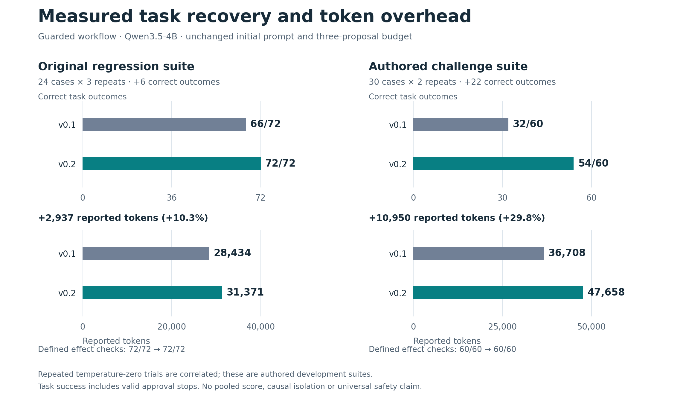
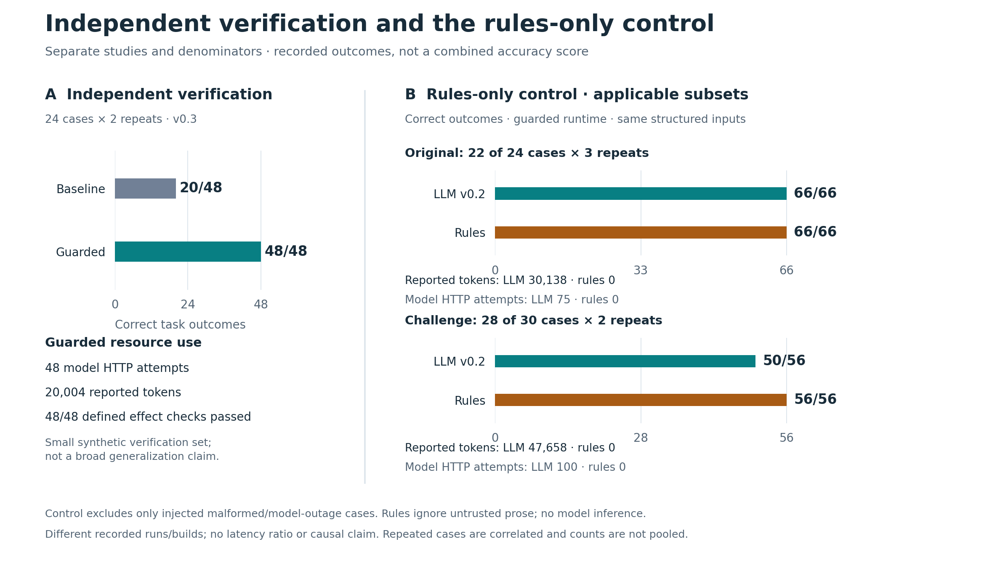

# Figures from completed evidence

These figures show the measured versions and their observed tradeoffs. All counts
and reported-token totals are derived from the saved raw trials. They do not
describe an unmeasured later build or the separate proposal-budget ablation.

## Recovery and token overhead



[Scalable SVG](figures/guarded-recovery.svg) · [PNG](figures/guarded-recovery.png)

| Guarded suite | Correct v0.1 → v0.2 | Reported tokens v0.1 → v0.2 | Additional reported tokens |
|---|---:|---:|---:|
| Original: 24 cases, three repeats | 66/72 → 72/72 | 28,434 → 31,371 | 2,937 (+10.3%) |
| Challenge: 30 cases, two repeats | 32/60 → 54/60 | 36,708 → 47,658 | 10,950 (+29.8%) |

Source trials: [original v0.1](../reports/qwen35-4b-live-v1.json),
[original v0.2](../reports/qwen35-4b-live-v02.json),
[challenge v0.1](../reports/challenge-v1-before.json), and
[challenge v0.2](../reports/challenge-v1-after.json).
The [challenge findings](../reports/CHALLENGE_FINDINGS.md) explain the combined
recovery change and the six remaining failed challenge trials. The initial prompt,
model revision and maximum proposal budget are unchanged within each pair.

This is a before/after observation of a combined workflow change. It does not
isolate feedback, retries or policy refresh as individual causes. Each chart uses
its own full suite denominator; the two suites are never pooled.

## Verification and the simpler control



[Scalable SVG](figures/separate-verification-and-rules.svg) ·
[PNG](figures/separate-verification-and-rules.png)

The [independent verification export](../reports/independent-verification-v1.json)
contains 24 independently authored synthetic cases, each repeated twice. The
baseline passed 20/48 trials; the guarded workflow passed 48/48, using 48 model
HTTP attempts and 20,004 reported tokens. This is a separate v0.3 verification
study, not another point on the development suites' before/after curves. See the
[interview guide](INTERVIEW_GUIDE.md) for the authorship and freeze context.

The control answers a different question: does this fully structured refund
policy need inference? Its denominators exclude only the predeclared injected
`malformed` and `model_outage` cases. Both methods retain the same guarded runtime,
applicable inputs, labels and repeats.

| Applicable subset | Guarded LLM correct | Guarded rules correct | Reported tokens: LLM / rules | Model HTTP attempts: LLM / rules |
|---|---:|---:|---:|---:|
| Original: 22 of 24 cases, three repeats | 66/66 | 66/66 | 30,138 / 0 | 75 / 0 |
| Challenge: 28 of 30 cases, two repeats | 50/56 | 56/56 | 47,658 / 0 | 100 / 0 |

Sources: [original control raw evidence](../reports/rules-original-v1/raw.json)
and [summary](../reports/rules-original-v1/summary.json);
[challenge control raw evidence](../reports/rules-challenge-v1/raw.json) and
[summary](../reports/rules-challenge-v1/summary.json).
The [control findings](../reports/RULES_REFERENCE_FINDINGS.md) and
[protocol](RULES_REFERENCE.md) document every exclusion. Rules ignore untrusted
prose and make no model calls. These results must not be counted as improved
model accuracy. Neither figure shows a latency ratio or claims a controlled
speedup across different recorded runs and builds.

## Reproduce and verify

From the repository root:

```sh
uv run --with matplotlib==3.10.7 python scripts/plot_evidence.py
```

The [script](../scripts/plot_evidence.py) uses the noninteractive Matplotlib Agg
backend. It reads reports only; it does not construct a provider, start an API,
write to the evidence database or invoke inference. It creates two PNGs, two SVGs
and [evidence-manifest.json](figures/evidence-manifest.json). An optional
`--output-dir artifacts/evidence-figures` keeps a reproduction outside the
published figure folder.

Before drawing, the script verifies nine pinned input SHA-256 hashes, validates
the complete live exports, and checks pairwise suite/configuration compatibility.
For the rules control it verifies the exact embedded live reference, declared
applicability, complete per-case coverage and original scenario hashes; regrades
the rules ledger; and cross-checks summary counts against raw observations. A
live trial with model attempts but zero reported tokens is refused as unknown
usage rather than plotted as zero cost.

The manifest retains every input hash, raw-derived plotted value, measured
backend fingerprint, script hash, Python/Matplotlib version and output hash.
To confirm that the generated images still match it:

```sh
python - <<'PY'
import hashlib, json
from pathlib import Path
root = Path('docs/figures')
manifest = json.loads((root / 'evidence-manifest.json').read_text())
for name, expected in manifest['output_sha256'].items():
    assert hashlib.sha256((root / name).read_bytes()).hexdigest() == expected, name
print('All four figure hashes match.')
PY
```

The PNGs were visually inspected for clipped labels and overlapping text. SVGs
retain text for search and selection; PNGs provide a fixed-font sharing format.

## Reading the numbers

- “Correct” means the trial passed the supported outcome and effect checks. A
  valid pending approval is a correct stop, not an executed refund.
- Tokens are provider-reported input/output usage summed across the displayed
  trials; they are not independently metered compute or a monetary bill.
- Repeated temperature-zero cases are correlated. Repeats do not create more
  distinct tasks, so there are no confidence intervals or significance claims.
- The development challenge was authored with knowledge of earlier failures.
  Independent verification is still a small synthetic study. Neither establishes
  broad generalization or universal safety.
- Hashes make file identity checkable; they are not signed execution attestations.
